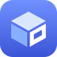
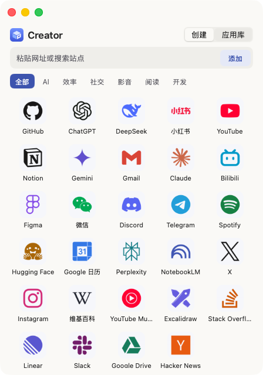
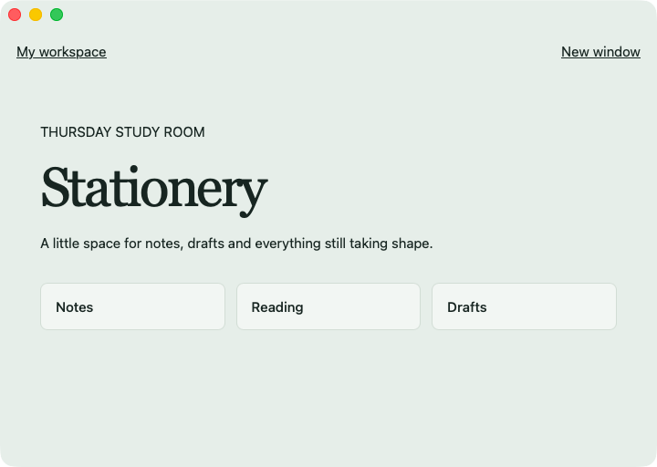

<p align="center"></p>
<h1 align="center">Creator</h1>
<p align="center">Turn websites into desktop apps.</p>
<p align="center">
  <a href="https://github.com/Bistutu/Creator/releases/latest">Download</a> ·
  <a href="docs/README.zh-CN.md">简体中文</a> ·
  <a href="docs/usage.md">User guide (中文)</a> ·
  <a href="https://github.com/Bistutu/Creator/issues">Feedback</a> ·
  <a href="LICENSE">MIT</a>
</p>

Creator gives a website its own window, icon, and launcher in your desktop app menu. Paste a URL or pick a preset, then create and open the app. Creator ships with its own launchers, so creating an app requires no compiler or build-tool download.

<p align="center">
  
  
</p>

## Download

Choose your system and architecture on the [latest release](https://github.com/Bistutu/Creator/releases/latest). Each release includes checksums and installation details.

| System | Package | Installation |
| --- | --- | --- |
| macOS 12+ | Universal DMG for Apple silicon and Intel | Open the DMG and drag Creator into Applications. |
| Windows | x64 or ARM64 installer or portable ZIP | Run the installer or extract the ZIP and open `Creator.exe`. Requires [WebView2 Runtime](https://developer.microsoft.com/microsoft-edge/webview2/). |
| Linux | x64 or ARM64 DEB or TAR.XZ | Install the DEB on Debian or Ubuntu, or extract the archive and run `creator`. Requires GTK 3 and WebKitGTK 4.1. |

The macOS installer uses an ad hoc signature and may need approval in Privacy & Security. [Apple's instructions](https://support.apple.com/guide/mac-help/open-a-mac-app-from-an-unidentified-developer-mh40616/mac)

## What you can do

- Paste or drag a full URL, or search presets such as DeepSeek, Xiaohongshu, GitHub, and Notion.
- Name the app, use the site's icon or pick an image, and set the initial window size.
- Launch from Creator or your system's app menu. Each app has its own website session.
- Open the saved home page, zoom, copy the current URL, or open it in your browser from the app's View menu.
- Use `⌘,` on macOS or `Ctrl+,` on Windows and Linux to set the appearance, startup page, and default size. Manage installed apps in the library.

## Develop

Creator's interface uses [MyGo](https://github.com/egoist/mygo) and its apps use the system WebView. Build with Go 1.27.3 or later and, on macOS, the Xcode command-line tools.

```sh
go run ./cmd/package -prepare
go tool mygo dev
```

GitHub Actions runs regressions and builds release packages. See the [test guide](docs/testing.md), [release guide](docs/releasing.md), and [website source](website/).

## License

Creator is released under the [MIT License](LICENSE). Installers include the [third-party license notices](resources/THIRD-PARTY-LICENSES.txt). Site logos identify their services and belong to their respective owners. The DeepSeek mark uses the [Lobe Icons license](resources/Lobe-Icons-LICENSE.txt). The packaging workflow was inspired by [Pake](https://github.com/tw93/Pake).
