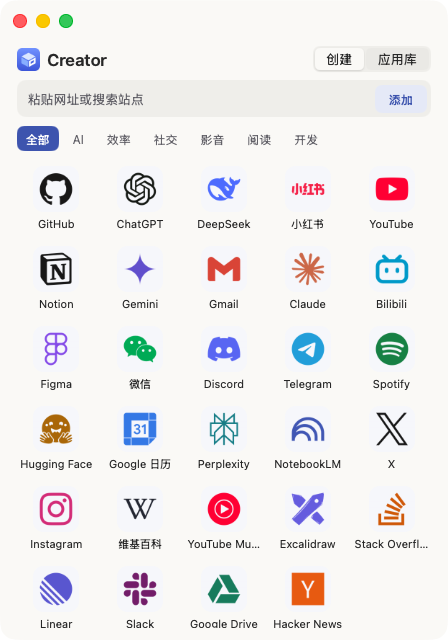
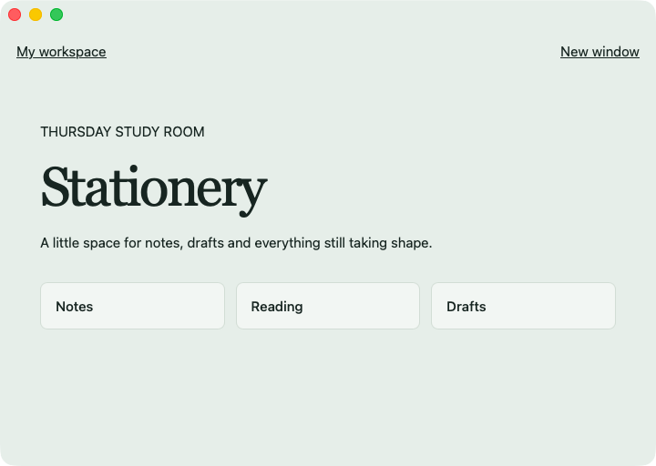

<p align="center"></p>
<h1 align="center">Creator</h1>
<p align="center">把常用网站变成独立的桌面应用。</p>
<p align="center">
  <a href="https://github.com/Bistutu/Creator/releases/latest">下载</a> ·
  <a href="../README.md">English</a> ·
  <a href="usage.md">使用指南</a> ·
  <a href="https://github.com/Bistutu/Creator/issues">问题反馈</a> ·
  <a href="../LICENSE">MIT</a>
</p>

Creator 为网站创建独立窗口、图标和系统应用入口。粘贴网址或选择推荐站点即可创建。安装包自带启动器，创建应用无需安装编译工具或下载构建依赖。

<p align="center">
  
  
</p>

## 下载安装

在 [最新版本](https://github.com/Bistutu/Creator/releases/latest) 选择系统和处理器架构。发布页附安装说明与校验文件。

| 系统 | 安装包 | 安装方式 |
| --- | --- | --- |
| macOS 12 及以上 | 通用 DMG，支持 Apple 芯片和 Intel | 打开 DMG，将 Creator 拖入「应用程序」。 |
| Windows | x64 或 ARM64 安装器与便携 ZIP | 运行安装器，或解压后打开 `Creator.exe`。需要 [WebView2 Runtime](https://developer.microsoft.com/microsoft-edge/webview2/)。 |
| Linux | x64 或 ARM64 的 DEB 与 TAR.XZ | 在 Debian 或 Ubuntu 上安装 DEB，也可解压后运行 `creator`。需要 GTK 3 和 WebKitGTK 4.1。 |

macOS 安装包使用临时签名，首次打开时可能需要在「隐私与安全性」确认。 [Apple 使用指南](https://support.apple.com/guide/mac-help/open-a-mac-app-from-an-unidentified-developer-mh40616/mac)

## 主要功能

- 直接粘贴或拖入完整网址，也可搜索 DeepSeek、小红书、GitHub、Notion 等推荐站点。
- 自定义应用名称、图标及初始窗口尺寸。多个应用分别保留站点会话。
- 从应用库或系统应用菜单打开。独立窗口的「显示」菜单提供回到首页、网页缩放、复制链接和用浏览器打开。
- 在 macOS 按 `⌘,`，在 Windows 或 Linux 按 `Ctrl+,` 调整外观、启动页和默认尺寸。应用库支持搜索和管理已创建的应用。

## 开发

管理器使用 [MyGo](https://github.com/egoist/mygo) 原生组件，独立应用使用系统 WebView。使用 Go 1.27.3 或更新版本。macOS 构建需要 Xcode 命令行工具。

```sh
go run ./cmd/package -prepare
go tool mygo dev
```

GitHub Actions 负责运行回归、构建安装包与发布版本。参见 [测试指南](testing.md)、[发布指南](releasing.md) 和 [官网源码](../website/)。

## 许可证

Creator 采用 [MIT 许可证](../LICENSE)。安装包附有 [第三方组件许可](../resources/THIRD-PARTY-LICENSES.txt)。推荐站点的标志用于识别服务，归各自权利方所有。DeepSeek 图标沿用 [Lobe Icons 许可](../resources/Lobe-Icons-LICENSE.txt)。网站打包功能受 [Pake](https://github.com/tw93/Pake) 启发。
